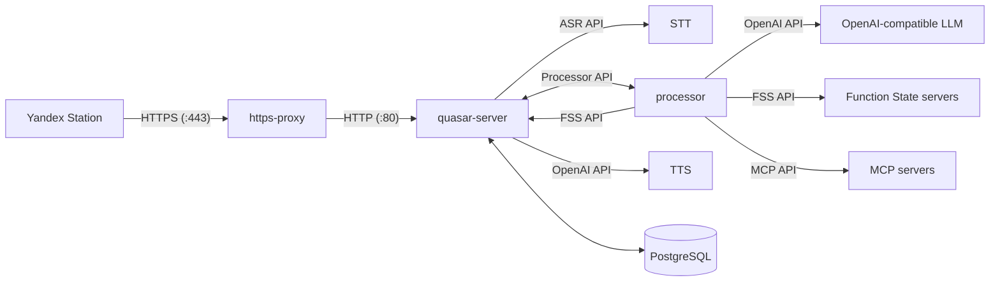

Basically the whole architecture looks like that:

## Main path

1. The device connects to the host by HTTPS. `https-proxy` terminates or forwards the Yandex-facing traffic.
2. `quasar-server` receives device traffic on `PORT`, and processes UniProxy requests
3. Audio goes to `quasistreaming-gigam` over WebSocket. The ASR service returns partial and final transcripts.
4. `quasar-server` sends a request through WebSocket to `processor`. Processor builds prompts, calls the configured OpenAI-compatible model, and can call function/state servers when configured.
5. `processor` returns response and directive to `quasar-server`
5. `quasar-server` sends text to `supertonic-tts` through its OpenAI-compatible speech endpoint and then sends it to device

## Why separate services?

Each service has one job. ASR and TTS can be replaced independently, processor changes do not require changing the station protocol, and model caches can be managed without touching the database. This also means the deployment has more moving parts than a single application: check logs for the service that owns the failing step.
