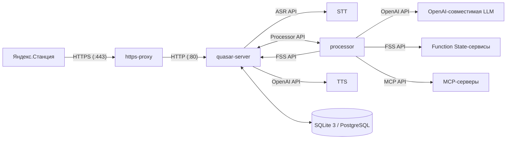

В общих чертах архитектура выглядит так:

## Основной путь

1. Устройство подключается к хосту по HTTPS. `https-proxy` принимает или пересылает трафик, предназначенный Яндексу.
2. `quasar-server` получает трафик устройства на `PORT` и обрабатывает запросы UniProxy.
3. Аудио передаётся в `quasistreaming-gigam` по WebSocket. ASR-сервис возвращает промежуточные и финальные транскрипции.
4. `quasar-server` отправляет запрос в `processor` по WebSocket. Processor формирует промпты, вызывает настроенную OpenAI-совместимую модель и при необходимости обращается к function/state-сервисам.
5. `processor` возвращает ответ и directives в `quasar-server`.
6. `quasar-server` отправляет текст в `supertonic-tts` через его OpenAI-совместимый speech endpoint, а затем передаёт результат устройству.

## Зачем нужны отдельные сервисы?

У каждого сервиса одна задача. ASR и TTS можно заменять независимо, изменения processor не требуют менять протокол станции, а кэши моделей можно обслуживать отдельно от базы данных. Обратная сторона такого подхода — в системе больше компонентов, чем в одном приложении: при сбое смотрите логи сервиса, который отвечает за проблемный этап.
